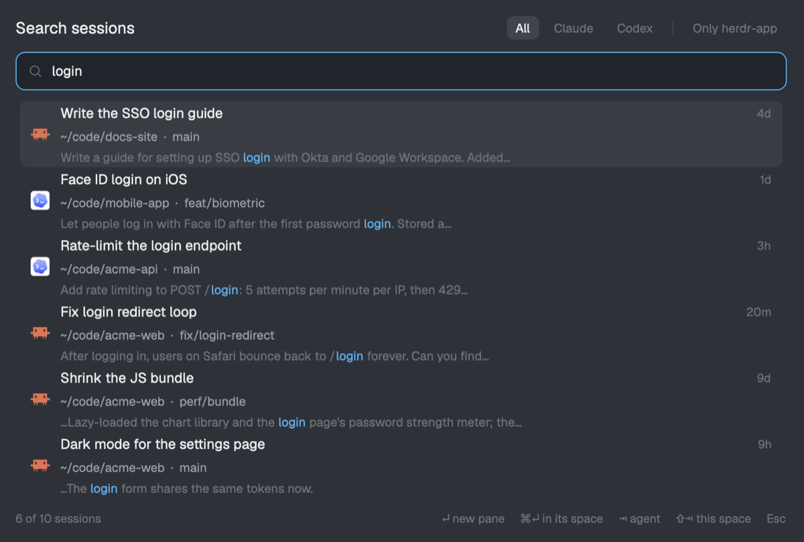

# Session Search for Herdr

Search your past **Claude Code**, **Codex** and **opencode** sessions by keyword from inside the
[Herdr](https://herdr.dev) desktop app, and resume one in a new pane with a single keypress.



- **Every session on this computer, whatever folder it ran in.** Projects, git worktrees and scratch folders are all searched. Each result shows its folder, git branch and, when one matches, the Herdr space already working there.
- **Full-text search.** Searches titles, your messages and the agent's replies, not just titles. Several words must all match, a partial word counts, and matched words are highlighted.
- **Resume in place.** Enter resumes the session in a new pane beside the focused one, started in the session's original folder. Cmd+Enter opens it as a new tab in the matching space, or in a new space if no space is working in that folder.
- **Fast.** A small SQLite full-text index is kept up to date as you search. Only changed session files are read again.

## Install

You need the Herdr desktop app on macOS or Linux, and `python3` at `/usr/bin/python3` (any Python 3.8+ with SQLite FTS5, which the system Python on macOS has).

1. Copy the mod into your Herdr home:

   ```sh
   git clone https://github.com/ilstar/herdr-session-search
   cp -R herdr-session-search/mods/session-search ~/.config/herdr-app/mods/
   ```

2. Add the shortcut to `~/.config/herdr-app/keys.json`, under `"global"` (see [`keys.json`](keys.json)):

   ```json
   "cmd-shift-h": "mod.open:session-search"
   ```

3. Check it:

   ```sh
   herdr-app check ~/.config/herdr-app/mods/session-search
   ```

Or ask the agent in your Herdr window: *"add the Herdr mod at github.com/ilstar/herdr-session-search"*. Herdr's own guide tells it how.

## Use

| Key | What it does |
| --- | --- |
| Cmd+Shift+H | Open the search popup |
| type | Search (empty: newest sessions first) |
| ↑ / ↓, PageUp / PageDown | Pick a session |
| Enter | Resume in a new pane beside the focused one |
| Cmd+Enter | Resume in a new tab of the space working in that folder (or a new space) |
| Tab | Cycle All / Claude / Codex / opencode |
| Shift+Tab | Only sessions in the current space's repo |
| Esc | Close |

Clicking a row resumes it too. Cmd+click opens it as a tab.

## How it works

`mods/session-search/index.py` reads the agents' own session files (read-only) and keeps a full-text
index in `~/.cache/herdr-session-search/index.db`:

| Agent | Session list | Resumed with |
| --- | --- | --- |
| Claude Code | `~/.claude/projects/<folder>/<session>.jsonl` (or `$CLAUDE_CONFIG_DIR`) | `claude --resume <id>` |
| Codex | the `threads` table in `~/.codex/state_*.sqlite`, plus each thread's rollout file (or `$CODEX_HOME`) | `codex resume <id>` |
| opencode | `~/.local/share/opencode/opencode.db` (or `$XDG_DATA_HOME/opencode`, `$OPENCODE_DATA_DIR`), opened read-only | `opencode --session <id>` |

Only what you and the agent wrote is indexed. Injected context (system reminders, environment
blocks, AGENTS.md), sub-agent sessions (including opencode child sessions) and Codex guardian reviews are left out. The index is only a
cache: delete the folder to rebuild it. Nothing leaves your machine. The mod makes no network requests.

You can run the indexer by hand:

```sh
python3 mods/session-search/index.py search --q "login redirect" --agent claude --limit 5
```

## Adding another agent

1. In `index.py`, write a `<name>_sources()` generator that yields `(key, signature, loader)` for each
   session, and a loader that returns a `Doc`. Then register it in `SOURCES`.
2. In `main.js`, add an entry to `AGENTS` with its name, icon and `resume` command.

## Limits

- Searches sessions on this computer only, not on remote Herdr machines.
- Claude Code finds a session by the folder it ran in, so a session whose folder was deleted can't be
  resumed. Such rows are marked "folder gone".
- Up to 400,000 characters of each conversation are indexed, and 80 results are shown.
- Archived Codex sessions stored as `.zst` need `zstd` on your `PATH` for their content. Their titles are indexed either way.

## Development

`dev/demo-data.py` writes made-up sessions so screenshots never show real ones:

```sh
python3 dev/demo-data.py /tmp/demo
CLAUDE_CONFIG_DIR=/tmp/demo/claude CODEX_HOME=/tmp/demo/codex OPENCODE_DATA_DIR=/tmp/demo/opencode \
  HERDR_SESSION_SEARCH_CACHE=/tmp/demo/cache \
  python3 mods/session-search/index.py search --q login
```

`RECIPE.md` is the brief for rebuilding the mod from scratch, as described in Herdr's sharing guide.

## License

[MIT](LICENSE)
