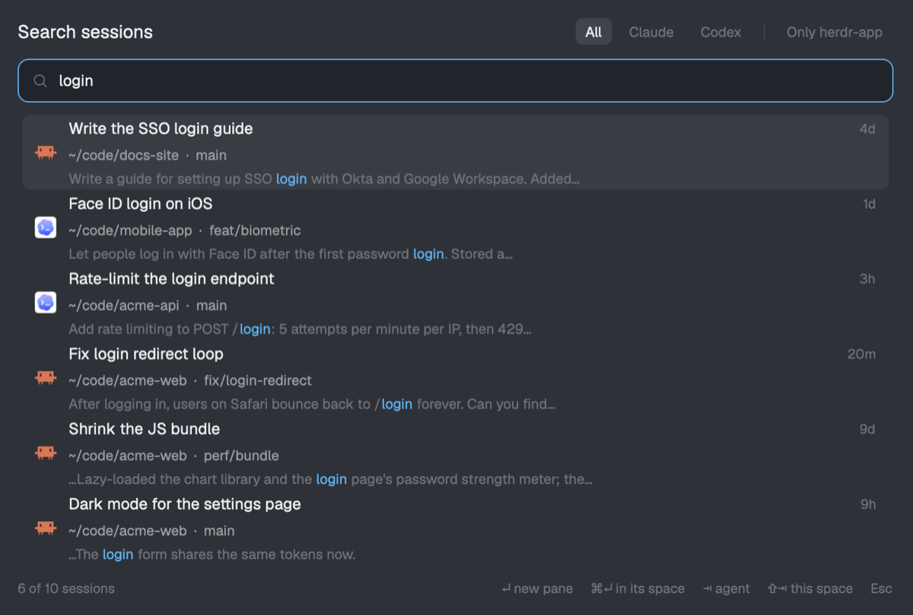

# Session Search

A popup that searches every past Claude Code and Codex session on this computer by keyword and
resumes the picked one in a new pane, in the folder the session ran in. Sessions from every folder
are searched. Each result says where it ran, and which Herdr space is already working there.

## What you see

A popup at the top of the window, 760px wide, offset 40px, on `popover`, 18px padding:

1. **Header row.** "Search sessions" (15px, semibold, `foreground`) on the left. On the right are filter
   chips (22px tall, 11.5px, radius 6; the selected one on `selected` in `foreground`, the others `dim`):
   All · Claude · Codex, a 1×14px `border` divider, then "Only <repo name>" (the current space's git root).
2. **Search box.** 36px tall, radius 9, 1px `accent` border on `background`. It has the shipped
   `mods/workspace-chrome/search.svg` icon (15px, `dim`), a text input (12.8px), and a spinning
   `mods/workspace-chrome/spinner.svg` (13px) while a search runs.
3. **Results.** Up to 8 rows of 62px each, then scrolling. Each row (radius 7, `hover` when selected or
   hovered) has:
   - the agent's icon (`icons/claude.svg` / `icons/codex.svg`, 18px, full color);
   - line 1: the session title (`foreground`, truncated), "archived" for archived Codex threads, and the
     age on the right (`now`, `20m`, `3h`, `4d`, then a date) in 11px `dim`;
   - line 2: the folder with `~` for home, ` · ` and the git branch (omitted when `HEAD`), in 11.5px `muted`.
     A missing folder shows in `blocked` with "(folder gone)". A space badge (10.5px, `raised`, radius 4)
     names the Herdr space whose terminals are in or around that folder;
   - line 3: the text around the match (11.5px `dim`, one line), matched words in `accent` semibold.
     With no query it shows the first message.
4. **Footer.** 11px `dim`: "6 of 10 sessions" (or "…, newest first" with no query, "Indexing… N sessions
   so far" during the first build, or the error in `blocked`), then key hints "↵ new pane", "⌘↵ in its space",
   "⇥ agent", "⇧⇥ this space", "Esc".

## How it behaves

- Opens with an empty query, listing the newest sessions first. Typing searches after a 140ms pause.
  Results are ranked by relevance, with title matches weighted 8×, folder 2× and conversation 1×.
- ↑/↓ wrap around. PageUp/PageDown move by a page. The wheel scrolls, and the selection follows it.
- Tab cycles the agent filter. Shift+Tab toggles "only this space's repo": sessions whose folder is the
  focused terminal's git root or inside it.
- Enter, or a click: resume beside the focused pane with `terminal.open {argv, folder: session cwd, place: "right", name: title}`.
  When no pane is focused (a layout terminal block, say), it opens as a tab instead.
- Cmd+Enter, or a Cmd+click: `tab.new {space, folder, argv, name}` in the matched space, else
  `space.new {folder, argv, tab: title}`.
- Claude sessions whose folder is gone aren't opened. A warning toast says why. Codex sessions there
  open in the home folder.
- Esc closes it. Opening a session closes it too.
- No agent statuses: it lists finished sessions, not live agents.

## Built from

- `mods/session-search/mod.json`: `{ "place": "none", "overlay": { "kind": "popup", "at": "top", "offset": 40, "width": 760, "height": 0.8 } }`.
  The key `"cmd-shift-h": "mod.open:session-search"` goes in the `global` section of `keys.json`.
- `main.js`: a `View` using `InputState`/`Input` from `gpui-base`. It calls `exec`, `spaces`, `panes`,
  `focused`, `run`, `theme`, `props`, `closeOverlay`, `home`, `appHome` and `notify` from `herdr`. An
  `AGENTS` table maps each agent to its name, icon and resume argv (`claude --resume <id>`,
  `codex resume <id>`). Space matching: of the panes in this computer's spaces, ignoring panes at home,
  the one whose cwd contains the session folder or sits inside it, longest path wins.
- `index.py`, run as `/usr/bin/python3 index.py search --q … [--agent] [--cwd] --limit 80 --budget 8`. Each call:
  1. lists sessions with a change signature: Claude `~/.claude/projects/*/*.jsonl` (mtime and size);
     Codex rows of `threads` in the newest `~/.codex/state_*.sqlite`, opened read-only, skipping
     `source` values that start with `{` (sub-agents), with the rollout file's mtime and size plus `updated_at_ms`;
  2. re-reads only changed sessions, within the time budget, newest first. It keeps user and assistant
     text, and strips `<system-reminder>`, `<environment_context>` and similar blocks;
  3. stores them in an FTS5 table (`title, body, cwd`, `unicode61 remove_diacritics 2`) at
     `~/.cache/herdr-session-search/index.db`, overridable with `$HERDR_SESSION_SEARCH_CACHE`;
  4. searches with each word as an AND-ed prefix term (`"word"*`), ordered by `bm25(fts, 8, 1, 2)`.
     The snippet is `snippet(…, char(1), char(2), '…', 14)`;
  5. prints `{results, pending, total}`. When `pending > 0` the mod searches again 50ms later.
- No art of its own. It uses the shipped program icons and workspace-chrome SVGs.

## Watch out

- A popup sizes to its content. A `flex_1()` result list collapses to 0px, so give the list an explicit
  height: `min(8, rows) × 62`.
- Don't render the list inside `overflow_y_scrollbar`. Keyboard selection needs the picker's approach:
  absolute rows at `i × ROW − scroll`, with the scroll kept so the selected row stays visible.
- Collapse whitespace in snippets and first messages. A newline makes a row wrap into the next one.
- Claude Code resolves `--resume <id>` against the current folder's project, so always start it in the
  session's cwd.
- Codex keeps `threads` rows for rollouts that no longer exist. Index their title and first message anyway.
  Archived rollouts may be `.jsonl.zst` (needs `zstd`).
- A pane at the home folder contains every path. Ignore it when matching spaces.
- `exec` has a 30s limit. Keep the indexing budget well under it, and let the mod call again.
- Remote machines' sessions aren't searched.

## Done when

- `herdr-app check mods/session-search` passes.
- Cmd+Shift+H opens the popup with the newest sessions listed. The footer reads "N of M sessions, newest first".
- Typing a word from inside a conversation (not its title) finds it, with that word highlighted in the snippet.
- Tab switches to Codex only, and only Codex icons remain. Shift+Tab limits rows to the current repo's folder.
- Enter on a Claude session opens a pane on the right running `claude --resume <id>` in that session's folder.
  The conversation is restored.
- Cmd+Enter on a session from a folder another space works in opens a new tab in that space.
- Deleting `~/.cache/herdr-session-search` and reopening rebuilds the index.
